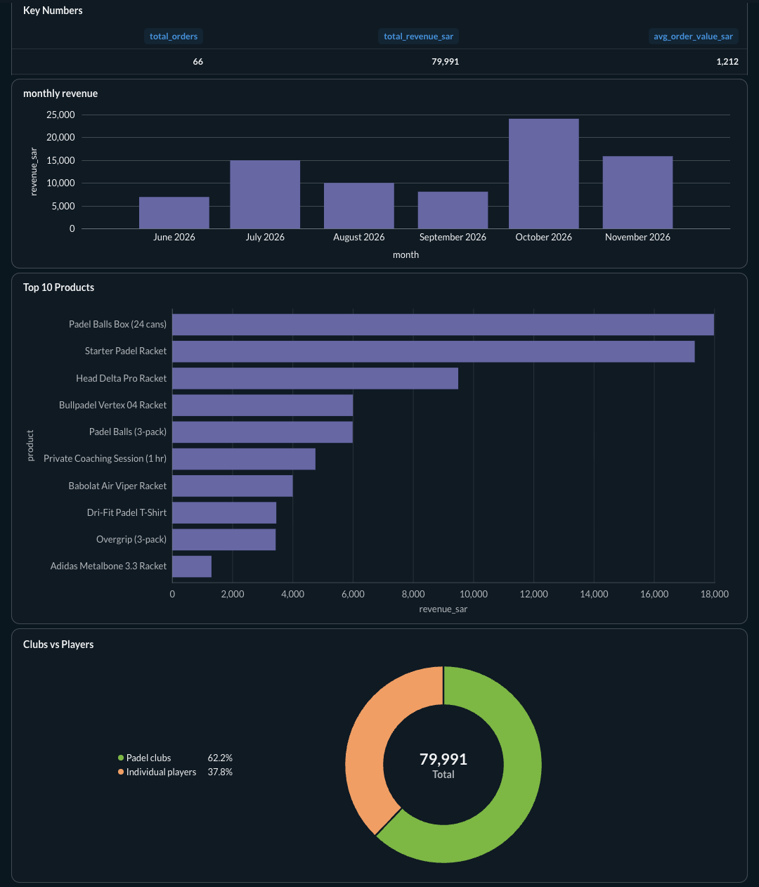
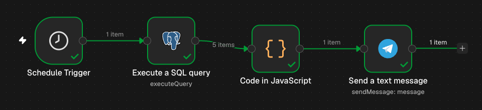
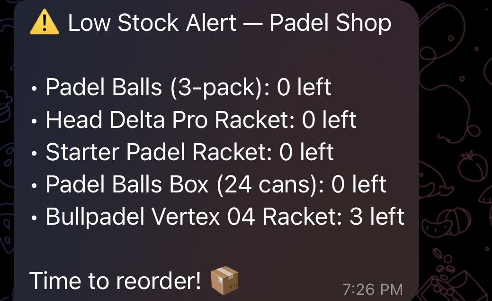

# Padel Shop Digital Transformation

A home-lab project that takes a simulated padel equipment shop from scattered, manual operations to a connected, data-driven setup, using free and open-source tools running on a Mac mini M4.

> **Note:** this is a simulated business with sample data, built for learning and as a portfolio project.



## The problem

Padel shops in the GCC are usually independent, small-scale businesses. Most run without an ERP or any central system, so operations are scattered: orders come in person or over WhatsApp, and stock, orders and sales updates are never connected in one place.

To know what is in stock, the owner has to check the storage room by hand. There is no real-time view of which products are selling fast and which are sitting on the shelf, tying up money.

## Phase 1: Visibility (done)

| Layer | Tool | What it does in the shop |
| --- | --- | --- |
| ERP | Odoo 18 | One system for products, stock, customers, orders, deliveries and invoices |
| Database | PostgreSQL 16 | Stores all of Odoo's data; Metabase and n8n read from it |
| Dashboard | Metabase | Revenue by month, top products, clubs vs. players, key numbers |
| Automation | n8n + Telegram | Checks stock every morning at 9:00 and sends a low-stock alert to my phone |
| Infrastructure | Docker Compose | Runs all four services as containers with one command |

### How it fits together

```
Odoo (ERP) ──writes──▶ PostgreSQL ◀──reads── Metabase (dashboard)
                            ▲
                            └──reads── n8n (9:00 daily) ──▶ Telegram alert
```

### Results (sample data, June–November 2026)

- 66 confirmed orders, 79,991 SAR revenue, average order 1,212 SAR
- Padel clubs brought in 62% of revenue from about 1 in 5 orders
- October was the peak month (about 24,000 SAR) as the padel season started
- The daily alert flagged 5 products as low or sold out

| n8n workflow | Telegram alert |
| --- | --- |
|  |  |

## Phase 2: Automation (planned)

- Automatic reordering with Odoo reordering rules
- Automatic invoicing once an order is delivered
- A Power BI version of the dashboard
- A weekly sales summary sent to the owner
- Project management documents: charter, WBS, timeline, risk register

## What's in this repository

| Path | Contents |
| --- | --- |
| `docker-compose.yml` | The four services (Odoo, PostgreSQL, Metabase, n8n) |
| `data/` | CSV files imported into Odoo: products, starting stock, customers |
| `scripts/seed_sales.py` | AI-assisted script that loads six months of simulated sales through Odoo's XML-RPC API |
| `sql/dashboard/` | The four SQL queries behind the Metabase dashboard |
| `sql/low_stock.sql` | The stock check run by n8n every morning |
| `n8n/format_message.js` | The n8n Code step that turns the results into one Telegram message |
| `screenshots/` | Dashboard, workflow and alert screenshots |

## Run it yourself

1. Install [Docker Desktop](https://www.docker.com/products/docker-desktop/).
2. Clone this repository and run `docker compose up -d` in its folder.
3. Open Odoo at `http://localhost:8069`, create a database called `padelshop`, and install Sales, Inventory and Invoicing.
4. Import the files in `data/` (products, then stock via Physical Inventory, then customers).
5. Load sample sales with `scripts/seed_sales.py` (instructions at the top of the file).
6. Open Metabase at `http://localhost:3000`, connect PostgreSQL (host `db`, database `padelshop`), and add the queries in `sql/dashboard/`.
7. Open n8n at `http://localhost:5678` and build: Schedule Trigger → Postgres (`sql/low_stock.sql`) → Code (`n8n/format_message.js`) → Telegram.

The passwords in `docker-compose.yml` are placeholders for a local machine only.
